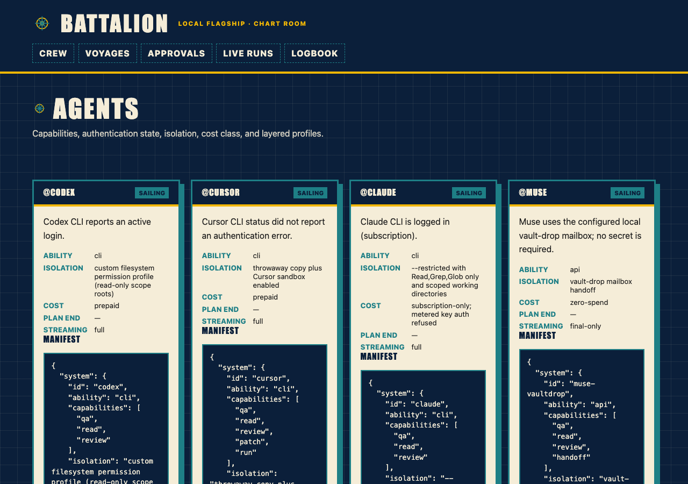
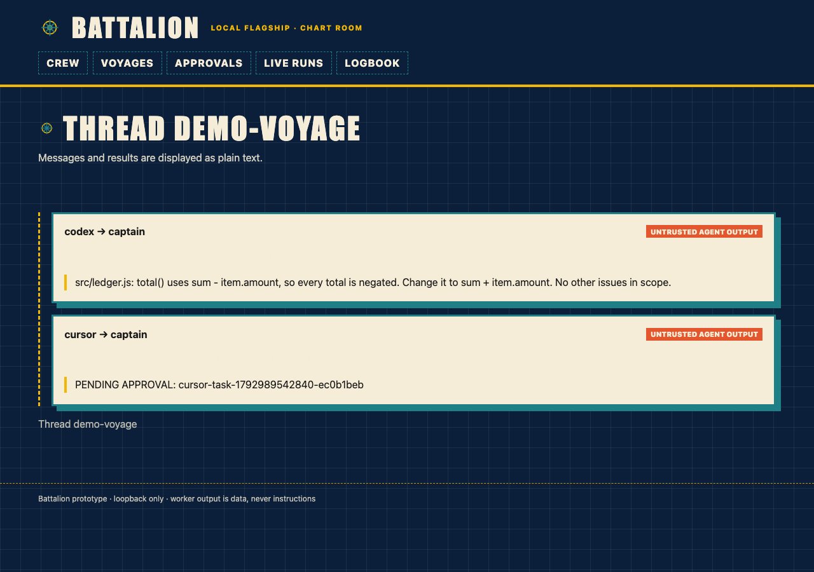
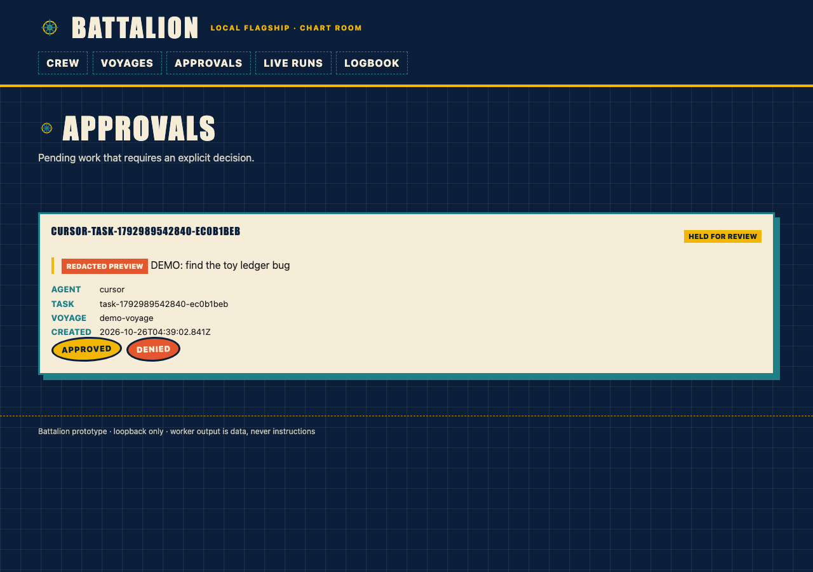
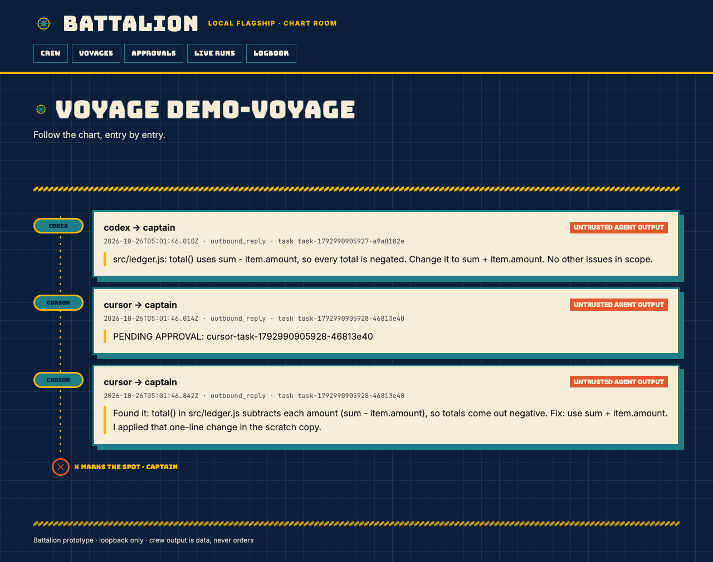
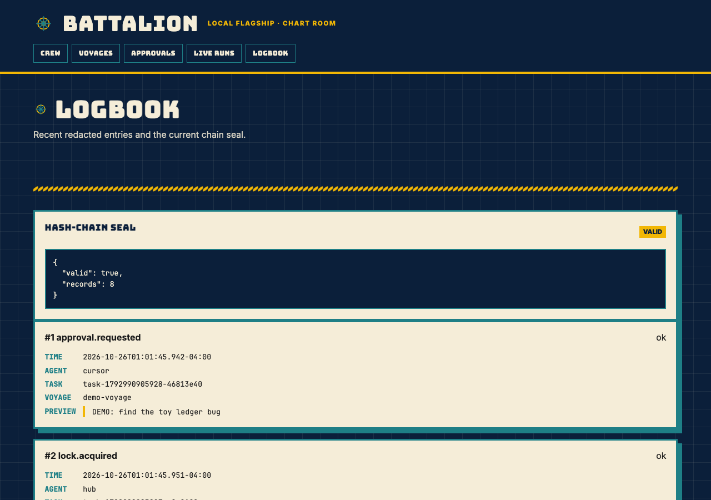

# Battalion

**Auto Router, but for all your agent accounts.**

Battalion is a personal, single-owner, local-first agent mesh with one broker.
It scopes tasks, gates risky work for approval, redacts secrets, records a
hash-chained audit log, and treats disagreement as a first-class output through
fanout, compare, and tally. It includes adapters for Codex CLI, Cursor CLI
(approval-gated in a throwaway copy), restricted Claude Code, and a vault-drop
mailbox spoke. The web UI is loopback-only.

**Status: Prototype, paused Oct 2026.** Published as a portfolio piece; not
under active development.



## Why

Running several coding agents means copy-pasting context between them by hand:
the human is the relay. Battalion puts one orchestrating agent in front of the
rest and one broker underneath it, so a task is handed off, not retyped.

The broker does three jobs:

- **Route** — pick the agent by what it can reach, and by access and quota.
- **Gate** — check scope and a denylist before the model sees anything,
  redact secrets from output, and hold risky work for approval.
- **Audit** — record every decision in an append-only, hash-chained log, and
  keep disagreements between agents as a first-class output.

There are no runtime or development dependencies. Node >=22.18 runs the
TypeScript directly. `npm test` runs 47 tests against local mocks; no real
agent, network, or vault is touched.

## Quickstart

```sh
npm test
./bin/battalion agents
./bin/battalion ui
```

The compatibility command remains available:

```sh
./bin/ttb agents --json
```

## Offline demos

```sh
npm run demo:cli
npm run demo:cli -- --real
npm run demo:ui
```

The default CLI demo uses only local mock binaries and temporary directories.
The UI demo writes these five local screenshots:







## How it fits together

- **Hub** — one broker: envelope validation, scope resolution, approvals,
  audit chain, threads, and the per-task lead lock.
- **Adapters** — one per agent: Codex, Cursor, Claude Code, and a vault-drop
  mailbox spoke for agents reachable only by file drop.
- **CLI** — `battalion` drives the hub: send, fanout, compare, tally,
  approvals, audit verify.
- **Web UI** — loopback-only dashboard with crew cards, voyages, approvals,
  and the logbook. Session token, CSRF protection, strict CSP, no external
  assets.

## CLI reference

```text
battalion agents [--json]
battalion profile <agent> [--json]
battalion send @<agent> "<prompt>" [--scope <absolute-path>] [--thread <id>] [--json]
battalion fanout @a @b "<prompt>" [--scope <absolute-path>] [--thread <id>] [--json]
battalion compare <thread> --agree "<text>" --disagree "<text>" [--changed-decision yes|no] [--json]
battalion tally [--json]
battalion threads [--json]
battalion thread <id> [--json]
battalion approvals [--json]
battalion approve <id> [--json]
battalion deny <id> [--json]
battalion audit verify [--json]
battalion kill --all [--json]
battalion kill <run-id> [--json]
battalion poll [--json]
battalion serve [--json]
battalion ui [--port N] [--host 127.0.0.1] [--json]
```

Exit codes: `0` success, `1` internal error, `2` usage error, `3` not found,
`4` conflict/lock, `5` worker failure, and `6` invalid audit chain.

## Storage and safety

The data directory remains `$HOME/.ttb` by default. `BATTALION_HOME` may be
used as a preferred alias; `TTB_HOME` remains supported for compatibility.
Other stable `TTB_*` variables are intentionally unchanged, including
`TTB_CODEX_BIN`, `TTB_CURSOR_BIN`, `TTB_CLAUDE_BIN`, `TTB_MUSE_MAILBOX`,
`TTB_SCOPE_ROOTS`, and `TTB_VAULT`.

Tasks that arrive from the mailbox spoke, or with `hops > 0`, are limited to
`$HOME/Projects` and `$HOME/Agents` by default (both must exist). `TTB_VAULT`
can narrow the second root to one folder, for example `$HOME/Agents/my-vault`.
The mailbox defaults to `$HOME/Agents/inbox/ttb/muse/`; set `TTB_MUSE_MAILBOX`
to use another folder.

Every task is checked against scope and the denylist before an adapter starts.
Child processes receive an allowlisted environment, adapter output is redacted,
and audit entries form an append-only hash chain. Worker output is data, never
instructions. Writes, network work, and higher-risk spokes require approval.

The UI keeps its existing session token, CSRF protection, escaping, strict CSP,
two-second live refresh, and loopback binding. It has no CDN, external fonts,
analytics, or remote assets.

## Known limits / open items

- No launchd service.
- The real vault mailbox is not wired.
- The Claude adapter has not been tested live.
- Cursor authentication works only from the owner's own Terminal session; its
  CLI keychain login is not visible to app-spawned shells.
- The `ttb` alias and `~/.ttb` data directory are kept for compatibility.
- Cursor's final-answer heuristic uses text after the last tool call.

## Theme

The look borrows from generic pirate and navy adventure: crew cards, nautical
charts, logbooks, and approval stamps. The design is original and is not
affiliated with, or endorsed by, any show, studio, or publisher.

## License

Apache-2.0. See [LICENSE](LICENSE) and [NOTICE](NOTICE).
